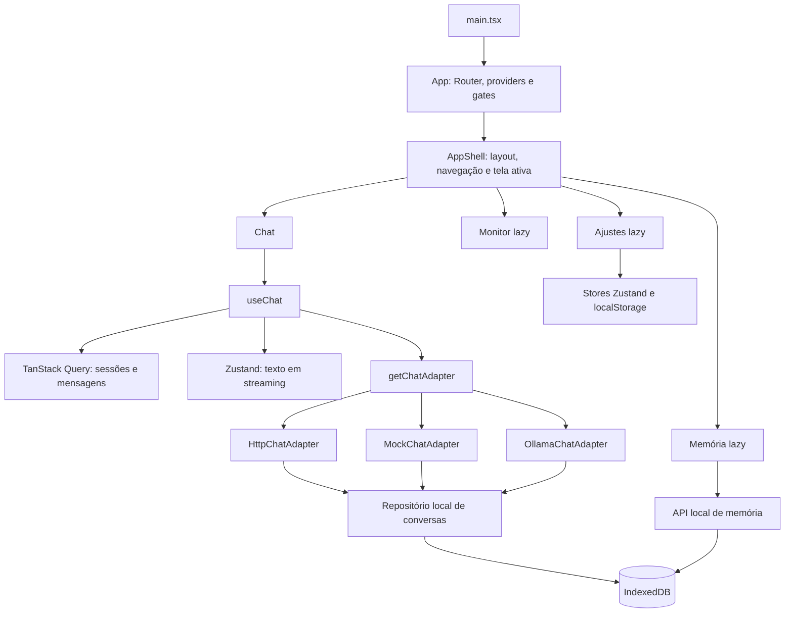

# Guia de arquitetura e manutenção do NEXA Web

Este guia explica como a aplicação é montada e onde fazer mudanças comuns. Foi escrito para consulta durante manutenção manual: comece pelo fluxo da funcionalidade, localize o módulo dono dos dados e preserve as fronteiras entre interface, estado e persistência.

## 1. Visão geral

O NEXA Web é uma SPA em React 19, TypeScript, Vite 8 e Tailwind CSS 4. A API HTTP, o adaptador de demonstração e o adaptador Ollama implementam a mesma interface de chat. As telas usam TanStack Query para dados assíncronos, Zustand para estado de aplicação e IndexedDB/localStorage para persistência no navegador.

## 2. Inicialização e composição

1. `src/main.tsx` importa fontes e estilos globais, registra Web Vitals e monta `<App />` em `#root`, dentro de `StrictMode`.
2. `src/app/App.tsx` aplica no `<html>` o tema, a preferência de movimento reduzido e o modo de efeitos. Também monta o `BrowserRouter`, `QueryClientProvider`, `ErrorBoundary`, `AuthGate` e `AppShell`.
3. `src/app/providers.tsx` fornece o `queryClient` compartilhado. O cliente e seus defaults ficam em `src/app/query-client.ts`.
4. `src/features/auth/AuthGate.tsx` deixa passar o modo offline, demonstração ou uma sessão válida; caso contrário, carrega a tela de autenticação sob demanda.
5. `src/features/layout/AppShell.tsx` compõe cabeçalho, navegação, avisos, fundo e conteúdo da tela atual.

`ChunkLoadBoundary` trata falha ao carregar uma tela dividida em chunk. `ErrorBoundary` trata erros de renderização que escapam das telas. Erros de requisição são tratados localmente com os estados de Query ou convertidos por `src/api/errors.ts`.

## 3. Pastas e responsabilidade

| Caminho | Responsabilidade | Pontos de entrada úteis |
|---|---|---|
| `src/app/` | Composição global, providers e cliente de Query. | `App.tsx`, `providers.tsx` |
| `src/api/` | Tipos, cliente HTTP, autenticação, catálogo, telemetria, Ollama e adaptadores. | `index.ts`, `types.ts`, `client/http.ts` |
| `src/api/adapters/` | Implementações intercambiáveis de chat e repositório de histórico. | `http.ts`, `mock.ts`, `ollama.ts`, `local-chat.ts` |
| `src/api/storage/` | Contrato e armazenamento IndexedDB do chat. | `types.ts`, `indexed-db.ts` |
| `src/features/` | Componentes e regras de cada área do produto. | `chat/`, `auth/`, `memory/`, `monitor/`, `settings/`, `layout/` |
| `src/components/ui/` | Primitivos visuais compartilhados. | `Button`, `Field`, `Panel`, `Badge`, `Switch`, `Skeleton` |
| `src/components/brand/` | Elementos de marca compartilhados. | `NexaMark.tsx` |
| `src/stores/` | Estado global cliente e preferências persistidas. | Stores Zustand por domínio |
| `src/hooks/` | Hooks transversais de navegador e layout. | `use-online-status.ts`, `use-visual-viewport.ts` |
| `src/lib/` | Funções utilitárias sem responsabilidade de tela. | `utils.ts`, `speech.ts`, `env.ts` |
| `src/styles/` | Tokens, temas e regras globais Tailwind/CSS. | `tokens.css`, `index.css` |
| `tests/` | Vitest e Testing Library. | Espelha API, stores, componentes e features |
| `e2e/` | Fluxos reais em navegador com Playwright. | Um arquivo por área; responsividade em `e2e/responsive/` |

As importações `@/...` apontam para `src/`; o alias está em `vite.config.ts` e também na configuração de testes.

## 4. Rotas e layout

O `BrowserRouter` está em `App.tsx`. `AppShell` resolve o conteúdo pelo `pathname`:

| Caminho | Conteúdo |
|---|---|
| `/` | Chat; se houver histórico, substitui a URL pela conversa ativa. |
| `/c/:sessionId` | Conversa indicada pelo ID. |
| `/memory` | Memórias locais. |
| `/monitor` | Telemetria da API ou do Ollama, conforme o modo. |
| `/settings` | Preferências, conta, chaves de provedores e conexão. |

Um caminho desconhecido volta para `/`. Memória, Monitor e Ajustes usam `lazy()` e `Suspense`; ao acrescentar tela, atualize a resolução de `activeView`, o conteúdo do `<main>`, a navegação em `Dock.tsx` e os testes de navegação. Preserve o `ChunkLoadBoundary` para falhas de importação dinâmica.

O `Dock` escolhe a rota com `navigate()`, então usar links reais e conservar a história do navegador mantém Voltar/Avançar funcionando. `SessionsSheet` e `ContextPanel` são drawers; notificações globais usam Sonner, montado no shell.

## 5. Dados, adaptadores e persistência

### Chat

`src/api/types.ts` define `ChatAdapter`, mensagens, sessões e eventos do stream. `src/api/index.ts` escolhe e instancia um adaptador uma vez, a partir do modo de conexão e das configurações:

- `HttpChatAdapter`: envia mensagens para a API, mas mantém sessões e histórico no navegador.
- `MockChatAdapter`: gera respostas locais em partes para demonstração e testes.
- `OllamaChatAdapter`: envia o histórico ao serviço Ollama pelo proxy `/ollama`.
- `IndexedDbChatRepository`: operações comuns de sessões e mensagens, compartilhadas pelos adaptadores.

`src/features/chat/api.ts` contém queries e mutations de sessão/mensagens. `useChat.ts` orquestra envio, abortamento, erros, leitura em voz alta, métricas e finalização da mensagem. O stream visual fica em `stream-store.ts` para evitar atualizar toda a lista a cada token; a mensagem final é gravada no cache de mensagens.

Ao alterar o formato do stream, atualize `ChatStreamEvent` em `src/api/types.ts`, o leitor de transporte correspondente e o consumidor em `use-chat.ts`. Preserve os eventos `meta`, `token`, `done` e `error` que cada adaptador suporta.

### Outras áreas

- Memória: `src/features/memory/api.ts` concentra validação, operações CRUD, cache e persistência local em IndexedDB. `MemoryView.tsx` é a tela; `MemoryForm.tsx` é o formulário.
- Modelos, saúde e uso da API: hooks em `src/api/models.ts`, `health.ts` e `usage.ts`, consumidos principalmente pelo Monitor e pelo Composer.
- Chaves de provedores: `src/api/provider-keys.ts` acessa o backend; `ProviderKeysPanel.tsx` cuida da interface e validação.
- Personalização: `src/features/chat/personalization.ts` seleciona nome e memórias relevantes para cada resposta.

### Estado: quem deve ser dono?

| Tipo de dado | Dono atual | Regra prática |
|---|---|---|
| Dados assíncronos e cache de API | TanStack Query | Use query/mutation e invalidação no módulo da feature/API. |
| Preferências e estado compartilhado simples | Zustand | Mantenha o store em `src/stores/` e seletores estreitos nos componentes. |
| Texto transitório do stream | `stream-store.ts` | Não mova os tokens para um store de preferências nem force re-render das outras mensagens. |
| Estado de formulário, modal ou filtro local | React (`useState`, React Hook Form) | Mantenha dentro da tela/componente quando não houver outro consumidor. |
| Histórico de chat | IndexedDB via repositório | Não grave o histórico de usuário na API: hoje o servidor não é a fonte dessas sessões. |

### Chaves de persistência

| Dado | Armazenamento |
|---|---|
| Preferências de interface | `localStorage`, `nexa:settings:v1` |
| Modo e configuração Ollama | `localStorage`, `nexa:connection:v1` |
| Modelo selecionado | `localStorage`, `nexa:model:v1` |
| Sessão guest | `localStorage`; sessão de usuário/admin em `sessionStorage` |
| Conversas | IndexedDB com namespaces por modo/identidade |
| Memórias | IndexedDB, chave `nexa:memory:v1` |
| Métricas da sessão | `sessionStorage`, `nexa:session-metrics:v1` |

Stores que leem o navegador protegem acesso a storage indisponível e aplicam defaults/sanitização. Ao introduzir uma preferência, atualize o tipo, default, sanitização, persistência, controles de Ajustes e `reset()`, além dos testes do store.

## 6. Estilos, componentes e layout responsivo

### Onde mudar aparência

- `src/styles/tokens.css`: variáveis semânticas de cor, tipografia, raio, espaço e elevação; temas ativados por `html[data-theme]`.
- `src/styles/index.css`: import Tailwind CSS 4, estilos base, safe areas, regras globais, animações e breakpoints customizados.
- `src/components/ui/`: primitivos reutilizáveis. `Panel` fornece padding padrão, título nomeado e superfície; `SectionCard` reaproveita esse painel.
- `src/lib/utils.ts`: `cn()` combina `clsx` e `tailwind-merge`, evitando conflitos de classes.
- O estilo de uma feature fica no JSX usando classes Tailwind; regras que dependam do estado do documento ou de muitos componentes vão para CSS global.

Prefira tokens como `bg-background`, `bg-surface`, `text-foreground`, `text-muted`, `border-border` e `text-primary`. Evite hex, RGB e estilo inline para cores de interface; temas dependem dos tokens. Valores inline são apropriados para dados variáveis, como largura de uma barra de progresso.

Não adicione outra cópia de estilos de botão, campo ou painel se o primitivo compartilhado atender. Se um primitivo mudar espaçamento, estados ou semântica, execute `tests/components/ui-primitives.test.tsx` e os fluxos e2e das telas que o usam.

### Temas e efeitos

`settings-store.ts` tipa e valida os temas; o seletor da tela de Ajustes atualiza o store. `App.tsx` aplica `data-theme`; os valores correspondentes estão em `tokens.css`. Ao criar tema, atualize os três pontos e o teste de persistência em `e2e/settings.spec.ts`.

`App.tsx` também calcula `data-fx` (`full`, `balanced` ou `lite`) a partir da configuração, movimento reduzido, memória/CPU reportadas e economia de dados. `GUIA_EFEITOS_VISUAIS.md` documenta o comportamento e os limites. Novos efeitos devem respeitar `prefers-reduced-motion` e `data-fx='lite'`.

### Responsividade e acessibilidade

Tailwind oferece breakpoints como `sm`, `md`, `lg`; `index.css` declara as variantes próprias `short` e `xs`. `.nexa-content-container` ativa container queries; `.nexa-cards-grid` organiza cartões com base na largura do conteúdo. Safe areas vêm de `env(safe-area-inset-*)`; `use-visual-viewport.ts` atualiza as variáveis usadas no teclado virtual.

Mantenha alvos interativos de pelo menos 44 px, label para campos, nome acessível em regiões e botões, foco visível e semântica HTML. Não dependa apenas de cor para comunicar estado. Use axe nos testes quando alterar navegação, diálogos ou controles.

## 7. Formulários, erros e conteúdo Markdown

Autenticação, perfil, memória e chaves usam React Hook Form + Zod (`@hookform/resolvers`). Schemas ficam junto ao domínio. Ao adicionar campo, modele limites e mensagens no schema, ligue `aria-invalid`/erro ao input e teste erro e envio válido. Erros da API são traduzidos com `describeError()` ou mapeados para `setError()` quando pertencem a um campo.

Chat usa `react-markdown` com sanitização e GFM. `split-markdown-blocks.ts` separa blocos para limitar trabalho repetido no streaming; código cercado carrega `HighlightedMarkdownBlock` sob demanda. Ao alterar renderização, preserve sanitização de HTML, links seguros, tabelas roláveis e o teste unitário do parser.

## 8. Configuração e API

`src/lib/env.ts` valida as variáveis Vite de execução com Zod. As variáveis suportadas e defaults estão na tabela “Configuração” da README e em `.env.example`. Não leia `import.meta.env` diretamente em componentes; adicione a variável ao schema e consuma pelo objeto `appEnv`.

Chamadas HTTP passam por `src/api/client/http.ts`; a configuração de origem está em `src/api/config.ts`. Erros de Problem Details são representados em `client/problem.ts`. O proxy da API e do Ollama é configurado em `vite.config.ts`; mantenha `/ollama` same-origin no navegador para evitar expor o serviço local.

Os tipos de API vêm de `src/api/openapi.snapshot.json`. Depois de atualizar o contrato, rode `npm run api:types`, revise `src/api/generated/openapi.d.ts` e valide com `npm run api:types:check`. Modelos do domínio ficam em `src/api/types.ts`; não use tipos gerados diretamente em componentes sem adaptação.

## 9. Como fazer mudanças comuns

### Adicionar uma tela

1. Crie a feature em `src/features/<nome>/`, mantendo API/hooks e componentes de apresentação próximos.
2. Faça lazy import no `AppShell` se a tela não precisar estar no chunk inicial.
3. Mapeie o pathname, fallback, navegação do Dock e caminhos desconhecidos.
4. Crie um teste Vitest da feature e um e2e que abra a rota e percorra a ação principal.

### Adicionar uma chamada da API

1. Declare o tipo de resposta em `src/api/` ou adapte o tipo OpenAPI.
2. Implemente a chamada no módulo de domínio adequado e use o cliente HTTP comum.
3. Exponha query/mutation com query keys estáveis; faça atualização otimista somente com rollback bem definido.
4. Mostre loading, vazio, sucesso e erro na tela; teste a resposta e a falha sem depender do backend real.

### Adicionar uma preferência

1. Amplie `AppSettings`, `DEFAULT_SETTINGS` e a sanitização em `settings-store.ts`.
2. Adicione o controle em `SettingsView.tsx` e atualize `reset()` se necessário.
3. Se a preferência precisa alterar DOM/CSS global, aplique-a em `App.tsx` por atributo `data-*` e limpe listeners no retorno do efeito.
4. Teste default, persistência após reload e aplicação visual.

### Adicionar estado de stream

Represente eventos de transporte em `ChatStreamEvent`; em `useChat`, atualize só a mensagem ativa e a store correspondente. Garanta que concluir, cancelar, falhar e trocar de conversa limpem timers, `AbortController`, fila de voz e estado transitório.

## 10. Testes, comandos e qualidade

| Comando | Uso |
|---|---|
| `npm run lint` | ESLint. |
| `npm run typecheck` | TypeScript da aplicação e configuração Node. |
| `npm test` | Vitest/Testing Library. |
| `npm run test:e2e` | Playwright, fluxos principais e acessibilidade. |
| `npm run test:responsive` | Projetos responsivos Chromium, toque, Firefox e WebKit. |
| `npm run build` | Typecheck e build de produção. |
| `npm run check:bundle` | Orçamento de JavaScript inicial gzip (200 kB). |
| `npm run check` | Lint, tipos, unit tests e build. |

Vitest usa `jsdom`, `tests/setup.ts` e `fake-indexeddb` onde necessário. Playwright define Vite em `playwright.config.ts`, injeta modo de demonstração e tem projetos por browser/dispositivo. Em e2e, prefira roles e labels acessíveis; evite seletores de classe CSS.

Antes de concluir mudança de UI, confira estado vazio/erro/loading, teclado e toque, persistência quando aplicável e telas estreitas. Para mudança de API, rode também os testes do adaptador; para mudança de tema/layout, rode `e2e/settings.spec.ts`, `e2e/monitor.spec.ts` ou `npm run test:responsive` conforme o alcance.

## 11. Checklist de manutenção

- A regra de negócio está no módulo de domínio, sem duplicação na tela?
- O estado foi colocado no dono certo (Query, store ou estado local)?
- A persistência e a migração/sanitização continuam compatíveis?
- A UI possui loading, vazio, erro e feedback de sucesso?
- Cores vêm dos tokens e controles mantêm label, foco e alvo de toque?
- A alteração precisa de teste unitário, e2e ou responsivo?
- Se entrou dependência ou import inicial, `check:bundle` continua dentro do orçamento?
- README ou este guia precisam de atualização?

## 12. Documentos relacionados

- [Design system do front-end](FRONTEND_DESIGN_SYSTEM.md): tokens, temas e primitivos visuais.
- [Guia de efeitos visuais](GUIA_EFEITOS_VISUAIS.md): modos, acessibilidade e restrições de movimento.
